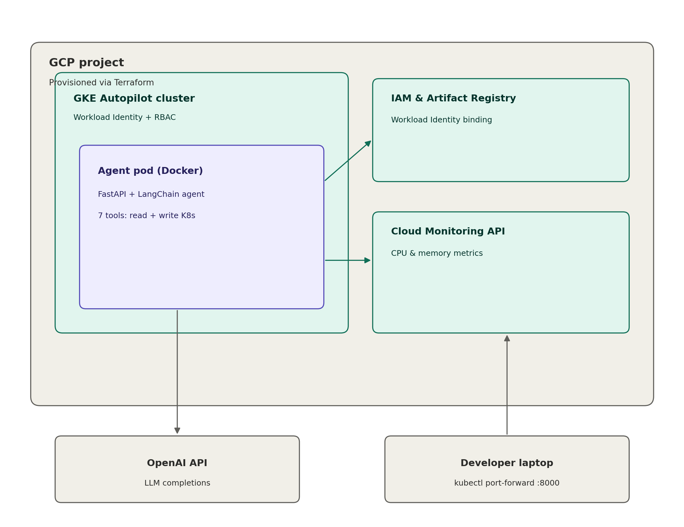
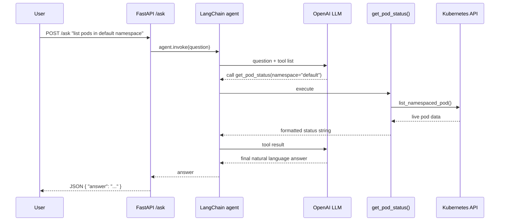
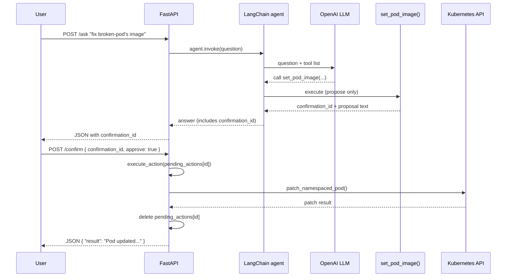

# Infra Copilot — AI Agent for GKE Monitoring & Remediation

An AI agent that monitors and can remediate issues in a live Google Kubernetes Engine (GKE) Autopilot cluster — checking pod health and resource usage, and fixing bad container images — deployed as a containerized API running **inside the same cluster it manages**. Built as an end-to-end learning project combining Infrastructure as Code, Kubernetes, and LLM-based tool-calling agents.

## What it does

Ask it questions in plain English, via HTTP:
- *"What pods are unhealthy right now?"*
- *"What's the CPU and memory usage in the default namespace?"*
- *"The broken-app deployment has a bad image, fix it to use nginx"*

For read-only questions, it answers immediately using live cluster data. For anything that would **change** the cluster (restarting a pod, patching an image), it proposes the action and waits for explicit human confirmation via a second API call before anything actually runs.

## Architecture



**Security model:**
- **Workload Identity** binds the agent's Kubernetes ServiceAccount to a GCP service account — no downloaded JSON key files, no long-lived static credentials.
- **Least-privilege RBAC** — the agent can `get/list/delete` Pods and `get/list/patch` Deployments only. It deliberately has **no write access** to StatefulSets, Jobs, or CronJobs (higher risk of data/ordering issues if patched or restarted automatically).
- **Human-in-the-loop confirmation** — every write action goes through a propose → confirm → execute flow (see below), not automatic execution. Confirmation IDs are single-use.
- **ClusterIP only** — the service is intentionally not exposed externally (no LoadBalancer/NodePort), since the API currently has no authentication and can modify infrastructure. Access is via `kubectl port-forward` only.

## Request flows

**Read-only question** (e.g. "list pods in default namespace") — the agent calls a tool and answers immediately, no confirmation needed:



**Write action** (e.g. "fix broken-pod's image") — the agent proposes the action; nothing changes until a separate, explicit confirmation call:



## How the confirmation flow works

1. `POST /ask` — the agent may call read tools automatically, or propose a write action:
   ```json
   { "answer": "Proposed action: set_pod_image ... Confirmation ID: abc-123. Call /confirm to execute." }
   ```
2. `POST /confirm` — approve or reject the specific action:
   ```json
   { "confirmation_id": "abc-123", "approve": true }
   ```
   Only at this point does the real Kubernetes API call happen. The ID is deleted after use — reusing it returns an error.

This exists because a containerized API can't use a blocking terminal prompt (`input()`) the way a CLI script can — the propose/confirm split is the HTTP-compatible equivalent of "are you sure? (yes/no)".

## Repository structure

```
infra-copilot-agent/
├── Iac/                             # Terraform: cluster, Workload Identity, RBAC
│   ├── providers.tf
│   ├── variables.tf
│   ├── apis.tf
│   ├── gke.tf
│   ├── workload_identity.tf
│   ├── rbac.tf
│   ├── terraform.tfvars.example    # copy to terraform.tfvars and fill in values
│   └── deploy.sh.example           # copy to deploy.sh and fill in values
├── k8s_manifest/                    # Kubernetes manifests
│   ├── infra_copilot_deployment.yaml
│   └── secret.yaml.example         # copy to secret.yaml and fill in real values
└── agent_code/                      # Application source
    ├── infra_monitor_agent_api.py
    ├── requirements.txt
    ├── Dockerfile
    └── build_script.sh.example     # copy to build_script.sh and fill in real values
```

## Prerequisites

- A GCP project with billing enabled
- `gcloud`, `terraform`, `kubectl`, and `docker` installed locally
- An OpenAI API key
- Authenticated locally: `gcloud auth login` and `gcloud auth application-default login`

## Setup

**1. Clone and configure**
```bash
git clone https://github.com/<your-username>/infra-copilot-agent.git
cd infra-copilot-agent

cp Iac/terraform.tfvars.example Iac/terraform.tfvars
cp k8s_manifest/secret.yaml.example k8s_manifest/secret.yaml
cp Iac/deploy.sh.example Iac/deploy.sh
cp agent_code/build_script.sh.example agent_code/build_script.sh
chmod +x Iac/deploy.sh agent_code/build_script.sh
```
Fill in the real values in each file:
- `Iac/terraform.tfvars` — your `project_id` and `region`
- `Iac/deploy.sh` — `CLUSTER_NAME`, `PROJECT_ID`, `REGION`, `IMAGE_TAG`
- `k8s_manifest/secret.yaml` — `GCP_PROJECT_ID` and `OPENAI_API_KEY`
- `agent_code/build_script.sh` — your `PROJECT_ID` (used to build the full image path)

**2. Build and push the agent image (first time, or after any code change)**
```bash
cd agent_code
./build_script.sh
cd ..
```

**3. Deploy everything (Terraform + Kubernetes)**
```bash
cd Iac
./deploy.sh
cd ..
```
This provisions the GKE Autopilot cluster, Workload Identity binding, and RBAC via Terraform, then applies the Kubernetes secret and deployment/service manifests.

**4. Access the agent**
```bash
kubectl port-forward service/infra-agent-app-service 8000:8000
```
```bash
curl http://localhost:8000/health

curl -X POST http://localhost:8000/ask \
  -H "Content-Type: application/json" \
  -d '{"question": "what pods are unhealthy right now?"}'
```

**5. Tear down when done (important — avoids ongoing cost)**
```bash
cd Iac
terraform destroy -auto-approve -var-file=terraform.tfvars
```

## Design notes / things learned building this

- **Image pulls use the node's service account, not the pod's Workload Identity.** Workload Identity governs what the *running application* can call (Cloud Monitoring, etc.); pulling the container image itself happens at the node level and requires `roles/artifactregistry.reader` on the node's Compute Engine service account.
- **In-cluster vs. local Kubernetes config are different code paths.** `config.load_kube_config()` only works with a local kubeconfig file (e.g. on a laptop); inside a pod, there is no such file — `config.load_incluster_config()` reads the automatically-mounted service account token instead. The agent tries in-cluster config first and falls back to local config, so the same script works in both environments.
- **`input()`-based confirmation cannot work in a containerized HTTP service.** The original CLI version blocked on a terminal prompt before executing a write action. Once containerized behind FastAPI, there's no terminal to prompt — this required redesigning write tools to store a *proposed* action and return a confirmation ID, with actual execution deferred to a separate `/confirm` call.
- **RBAC scope was a deliberate design decision, not just "grant everything."** Read access covers Deployments, StatefulSets, DaemonSets, Jobs, and CronJobs; write access is intentionally limited to Pods and Deployments only, since automated changes to stateful or batch workloads carry meaningfully higher risk.
- **Known limitation:** the `pending_actions` store (tracking proposed-but-unconfirmed actions) is in-memory and per-pod. With more than one replica, a `/confirm` call can land on a different pod than the `/ask` call that created it, incorrectly reporting "unknown confirmation_id." Currently mitigated by running a single replica; a production fix would move this state to Redis or a database.
- **No authentication on the API itself** — this is why the service is deliberately kept `ClusterIP`-only rather than exposed via LoadBalancer/NodePort. A production version would add API-key or Identity-Aware Proxy authentication before considering external exposure.

## Possible next steps

- [ ] Move `pending_actions` to Redis for multi-replica support
- [ ] Add API-key or IAP authentication before any external exposure
- [ ] CI/CD pipeline (GitHub Actions) to automate build + deploy
- [ ] Structured audit logging of every proposed and executed action
- [ ] Slack integration so confirmations happen where the team already works

## About me

Cloud/DevOps engineer (AWS, GCP, Terraform, Kubernetes) building AI agents that integrate directly with cloud infrastructure. 
