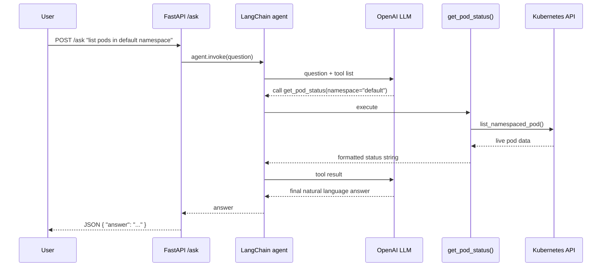
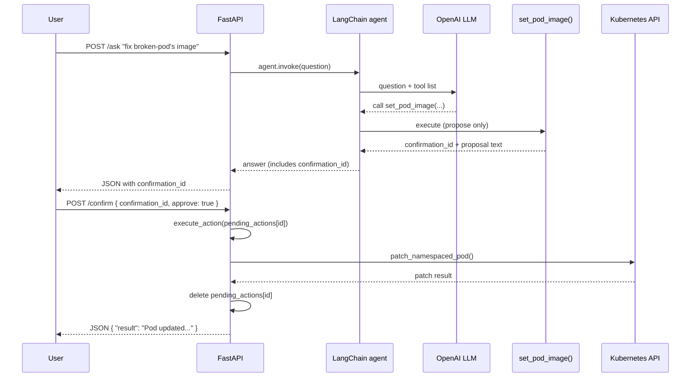

# Infra Copilot — AI Agent for GKE Monitoring & Remediation


An AI agent that monitors and can remediate issues in a live Google Kubernetes Engine (GKE) Autopilot cluster — checking pod health and resource usage, and fixing bad container images — deployed as a containerized API running **inside the same cluster it manages**. Built as an end-to-end learning project combining Infrastructure as Code, Kubernetes, and LLM-based tool-calling agents.

## What it does

Ask it questions in plain English, via HTTP:
- *"What pods are unhealthy right now?"*
- *"What's the CPU and memory usage in the default namespace?"*
- *"The broken-app deployment has a bad image, fix it to use nginx"*

For read-only questions, it answers immediately using live cluster data. For anything that would **change** the cluster (restarting a pod, patching an image), it proposes the action and waits for explicit human confirmation via a second API call before anything actually runs.

## Demo


*Asking the agent to check pod health, then confirming a proposed image fix via `/confirm`.*

## Architecture


**Security model:**
- **Workload Identity** binds the agent's Kubernetes ServiceAccount to a GCP service account — no downloaded JSON key files, no long-lived static credentials.
- **Least-privilege RBAC** — the agent can `get/list/delete` Pods and `get/list/patch` Deployments only. It deliberately has **no write access** to StatefulSets, Jobs, or CronJobs (higher risk of data/ordering issues if patched or restarted automatically).
- **Human-in-the-loop confirmation** — every write action goes through a propose → confirm → execute flow (see below), not automatic execution. Confirmation IDs are single-use.
- **ClusterIP only** — the service is intentionally not exposed externally (no LoadBalancer/NodePort), since the API currently has no authentication and can modify infrastructure. Access is via `kubectl port-forward` only.

## Request flows

**Read-only question** (e.g. "list pods in default namespace") — the agent calls a tool and answers immediately, no confirmation needed:



**Write action** (e.g. "fix broken-pod's image") — the agent proposes the action; nothing changes until a separate, explicit confirmation call:



## How the confirmation flow works

1. `POST /ask` — the agent may call read tools automatically, or propose a write action:
   ```json
   { "answer": "Proposed action: set_pod_image ... Confirmation ID: abc-123. Call /confirm to execute." }
   ```
2. `POST /confirm` — approve or reject the specific action:
   ```json
   { "confirmation_id": "abc-123", "approve": true }
   ```
   Only at this point does the real Kubernetes API call happen. The ID is deleted after use — reusing it returns an error.

This exists because a containerized API can't use a blocking terminal prompt (`input()`) the way a CLI script can — the propose/confirm split is the HTTP-compatible equivalent of "are you sure? (yes/no)".

## Repository structure

```
infra-copilot-agent/
├── Iac/                             # Terraform: cluster, Workload Identity, RBAC
│   ├── providers.tf
│   ├── variables.tf
│   ├── apis.tf
│   ├── gke.tf
│   ├── workload_identity.tf
│   ├── rbac.tf
│   ├── terraform.tfvars.example    # copy to terraform.tfvars and fill in real values
│   ├── deploy.sh                   # end-to-end deploy (gitignored — has hardcoded project config)
│   └── deploy.sh.example           # placeholder version, safe to commit
├── k8s_manifest/                    # Kubernetes manifests
│   ├── infra_copilot_deployment.yaml
│   └── secret.yaml.example         # copy to secret.yaml and fill in real values
└── agent_code/                      # Application source
    ├── infra_monitor_agent_api.py
    ├── requirements.txt
    ├── Dockerfile
    ├── build_script.sh             # builds and pushes the image to Artifact Registry
    └── build_script.sh.example     # placeholder version, safe to commit
```

**Note:** interview prep notes and command cheat sheets are kept in a separate private repo, since this repo is public.

## Prerequisites

- A GCP project with billing enabled
- `gcloud`, `terraform`, `kubectl`, and `docker` installed locally
- An OpenAI API key
- Authenticated locally: `gcloud auth login` and `gcloud auth application-default login`

## CI/CD pipeline

Two GitHub Actions workflows, authenticated to GCP via **Workload Identity Federation** (no downloaded JSON key stored in GitHub — the same keyless-auth principle used for the agent pod itself, applied here to the CI pipeline):

```
1. Developer pushes code to `dev`, opens PR to `main`
        │
        ▼
2. PR reviewed and merged into `main` (touches agent_code/**)
        │
        ▼
3. build-and-push.yml fires:
   - builds + pushes image tagged with the commit SHA
   - patches k8s_manifest/infra_copilot_deployment.yaml with the new tag
   - opens a SEPARATE auto-generated PR with that change (does not commit
     directly to main — see "Why an auto-generated PR" below)
        │
        ▼
4. Auto-generated PR reviewed and merged into `main`
        │
        ▼
5. sync-manifest-to-cluster.yml fires (triggered by the k8s_manifest/** change)
   - authenticates via Workload Identity Federation
   - applies the manifest to the live GKE cluster
   - the running Deployment now uses the new image
```

A manifest-only change (edited directly, not via a code PR) skips straight to step 4 — merging it into `main` triggers `sync-manifest-to-cluster.yml` directly, since `build-and-push.yml`'s path filter (`agent_code/**`) won't match.

**Why an auto-generated PR instead of a direct commit:** `main` is protected and requires review. A bot committing straight to `main` would either be blocked by that protection or would silently bypass review for an automated change. Instead, the bot pushes to its own short-lived branch (`ci/update-image-<sha>`) and opens a PR — every change that reaches `main`, human or automated, goes through the identical review gate.

**Debugging notes from setting this up:**
- `gh pr create --label` fails if the label doesn't already exist in the repo — labels must be created first, or the flag dropped.
- GitHub-hosted runners don't have `gke-gcloud-auth-plugin` preinstalled, so raw `gcloud container clusters get-credentials` generates a kubeconfig that `kubectl` can't actually use. Fixed by using the `google-github-actions/get-gke-credentials` action instead, which handles this automatically.
- `gh run rerun` replays a failed run using the workflow file **as it existed at that commit** — it does not pick up subsequent fixes to the workflow itself. Testing a workflow-file fix requires either a new triggering push, or adding a `workflow_dispatch` trigger and using `gh workflow run` instead, which always uses the current file on the target branch.

## Audit logging

Every proposed action, confirm/reject decision, and execution result is emitted as a single-line JSON object to stdout, which GKE's Cloud Logging collects automatically — no extra logging agent or sidecar required.

Example sequence from a real session:
```json
{"timestamp": "...", "event": "question_asked", "question": "broken-pod is unhealthy, set image to nginx:latest"}
{"timestamp": "...", "event": "action_proposed", "confirmation_id": "e7160b76-...", "action": "set_pod_image", "pod_name": "broken-pod", "new_image": "nginx:latest", "namespace": "default"}
{"timestamp": "...", "event": "action_confirmed", "confirmation_id": "e7160b76-...", "action": "set_pod_image"}
{"timestamp": "...", "event": "action_executed", "action": "set_pod_image", "pod_name": "broken-pod", "new_image": "nginx:latest", "namespace": "default", "success": true}
```

Events logged: `question_asked`, `action_proposed`, `action_confirmed`, `action_rejected`, `action_executed` (with `success: true`), `action_failed` (with `success: false` and the underlying Kubernetes API error reason), and `confirm_unknown_id` (an invalid or already-used confirmation ID).

View live: `kubectl logs -l app=infra-agent-app --tail=50`, or query in **Cloud Logging** with a filter such as `jsonPayload.event="action_executed"`.

**To audit one specific action end-to-end**, filter by its `confirmation_id` (returned in the `/ask` response and visible in the `action_proposed` log line) to pull the full propose → confirm → execute sequence for that single change:
```
resource.type="k8s_container"
resource.labels.container_name="infra-agent-container"
jsonPayload.confirmation_id="e7160b76-63d5-4a53-874e-71ea0bea7289"
```
or via `gcloud`:
```bash
gcloud logging read 'jsonPayload.confirmation_id="e7160b76-63d5-4a53-874e-71ea0bea7289"' --format json
```

## Setup

**1. Clone and configure**
```bash
git clone https://github.com/<your-username>/infra-copilot-agent.git
cd infra-copilot-agent

cp Iac/terraform.tfvars.example Iac/terraform.tfvars
cp k8s_manifest/secret.yaml.example k8s_manifest/secret.yaml
cp Iac/deploy.sh.example Iac/deploy.sh
cp agent_code/build_script.sh.example agent_code/build_script.sh
chmod +x Iac/deploy.sh agent_code/build_script.sh
```
Fill in the real values in each file:
- `Iac/terraform.tfvars` — your `project_id` and `region`
- `Iac/deploy.sh` — `CLUSTER_NAME`, `PROJECT_ID`, `REGION`, `IMAGE_TAG`
- `k8s_manifest/secret.yaml` — `GCP_PROJECT_ID` and `OPENAI_API_KEY`
- `agent_code/build_script.sh` — your `PROJECT_ID` (used to build the full image path)

**2. Build and push the agent image (first time, or after any code change)**
```bash
cd agent_code
./build_script.sh
cd ..
```

**3. Deploy everything (Terraform + Kubernetes)**
```bash
cd Iac
./deploy.sh
cd ..
```
This provisions the GKE Autopilot cluster, Workload Identity binding, and RBAC via Terraform, then applies the Kubernetes secret and deployment/service manifests.

**4. Access the agent**
```bash
kubectl port-forward service/infra-agent-app-service 8000:8000
```
```bash
curl http://localhost:8000/health

curl -X POST http://localhost:8000/ask \
  -H "Content-Type: application/json" \
  -d '{"question": "what pods are unhealthy right now?"}'
```

**5. Tear down when done (important — avoids ongoing cost)**
```bash
cd Iac
terraform destroy -auto-approve -var-file=terraform.tfvars
```

## Design notes / things learned building this

- **Image pulls use the node's service account, not the pod's Workload Identity.** Workload Identity governs what the *running application* can call (Cloud Monitoring, etc.); pulling the container image itself happens at the node level and requires `roles/artifactregistry.reader` on the node's Compute Engine service account.
- **In-cluster vs. local Kubernetes config are different code paths.** `config.load_kube_config()` only works with a local kubeconfig file (e.g. on a laptop); inside a pod, there is no such file — `config.load_incluster_config()` reads the automatically-mounted service account token instead. The agent tries in-cluster config first and falls back to local config, so the same script works in both environments.
- **`input()`-based confirmation cannot work in a containerized HTTP service.** The original CLI version blocked on a terminal prompt before executing a write action. Once containerized behind FastAPI, there's no terminal to prompt — this required redesigning write tools to store a *proposed* action and return a confirmation ID, with actual execution deferred to a separate `/confirm` call.
- **RBAC scope was a deliberate design decision, not just "grant everything."** Read access covers Deployments, StatefulSets, DaemonSets, Jobs, and CronJobs; write access is intentionally limited to Pods and Deployments only, since automated changes to stateful or batch workloads carry meaningfully higher risk.
- **Known limitation:** the `pending_actions` store (tracking proposed-but-unconfirmed actions) is in-memory and per-pod. With more than one replica, a `/confirm` call can land on a different pod than the `/ask` call that created it, incorrectly reporting "unknown confirmation_id." Currently mitigated by running a single replica; a production fix would move this state to Redis or a database.
- **No authentication on the API itself** — this is why the service is deliberately kept `ClusterIP`-only rather than exposed via LoadBalancer/NodePort. A production version would add API-key or Identity-Aware Proxy authentication before considering external exposure.

## Possible next steps

- [x] Structured audit logging of every proposed and executed action
- [x] CI/CD pipeline (GitHub Actions) to automate build + deploy
- [ ] Move `pending_actions` to Redis for multi-replica support
- [ ] Add API-key or IAP authentication before any external exposure
- [ ] Slack integration so confirmations happen where the team already works

## About me

Cloud/DevOps engineer (AWS, GCP, Terraform, Kubernetes) building AI agents that integrate directly with cloud infrastructure. [Add your LinkedIn / portfolio link here]
